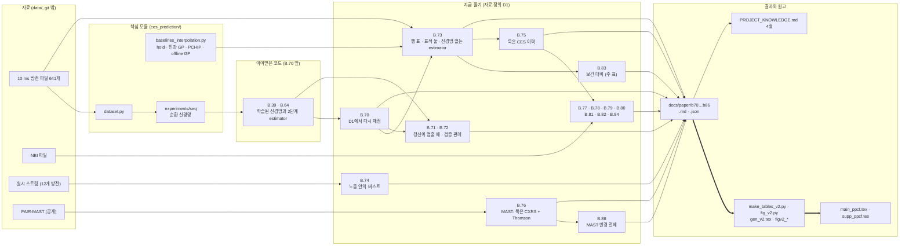

# KSTAR CES nowcasting — pedestal top

KSTAR 2022 캠페인의 pedestal top 측정선에서 CES 이온 온도를, 다음 CES 값을 기다리지 않고 10 ms마다 추정하는(nowcasting) 연구의 코드, 기록, 원고다. 입력은 그 측정선의 CES 이력과 같은 위치의 빠른 진단(BES, ECEI)이다.

> **For readers of the manuscript.** The registrations of the batches are `ces_prediction/experiments/PREREGISTRATION_B{NN}.md`, their results `docs/paper/b{NN}_*.md` and `.json`. Every number of the manuscript is generated from those result files by `docs/paper/ppcf/make_tables_v2.py`. The KSTAR shot files cannot be redistributed; the MAST data are public (FAIR-MAST) and are fetched by `ces_prediction/experiments/mast/fetch_*.py`.

이 문서는 **배선**을 적는다: 무엇이 무엇을 읽고, 어디로 가는가. 어떻게 돌리는가는 `HANDOVER.md`, 무엇을 정했는가는 `PAPER_DESIGN.md`, 무엇이 나왔는가는 `PROJECT_KNOWLEDGE.md`에 있다.

## 1. 연구의 줄기

저자의 틀: pedestal top에서의 nowcasting 문제를 푼다. 보간법 등에 견주어 가장 좋은 모델을 찾는다. 지금 가진 자원으로 10 ms 실시간이 되어야 하고, 적용했을 때 더 잘 작동함을 보이면 더 좋다.

| 질문 | 재는 배치 | 원고의 절 | 기록 (`PROJECT_KNOWLEDGE.md`) |
|---|---|---|---|
| 1. 어느 estimator가 가장 좋은가 (hold, 인과 GP, 다음 값을 기다리는 PCHIP·offline GP 대비) | B.83, B.73, B.70 | 결과 4.1 | 4.68절, 4.54절, 4.48절 |
| 2. 빠른 진단이 CES 이력에 더하는 것 | B.73, B.79, B.81, B.82 | 결과 4.2 | 4.54절, 4.61절, 4.65절, 4.66절 |
| 3. 방전을 달리 나눠도, 시간 순으로도, 실시간으로 | B.72, B.73, B.75 | 결과 4.3 | 4.51절, 4.54절, 4.55절 |
| 4. 적용했을 때: CES가 늦거나 드물 때, 둘째 장치 | B.75, B.78, B.77, B.84, B.71, B.76, B.86 | 결과 4.4, 4.5 | 4.55절, 4.58절, 4.57절, 4.69절, 4.49절, 4.59절, 4.71절 |
| 5. 성립하지 않는 곳 | B.75(마지막 블록), B.80, B.82, B.84 | 결과 4.6, 고찰 | 4.62–4.64절, 4.66절, 4.69절 |

논문의 estimator는 신경망이 아니다: 과거 CES 값에 대한 인과 Gaussian process 위에, CES 이력의 스칼라와 빠른 진단의 스칼라를 읽는 boosted regression을 얹은 것이다. 순환 신경망과 그 2단계 estimator는 비교 행이다.

## 2. 배선도

화살표는 "읽는다 → 만든다"의 방향이다. 굵은 테두리가 원고로 들어가는 길이다.



## 3. 노드

### 3.1 자료와 캐시 (git 밖)

| 노드 | 무엇 | 누가 읽는가 |
|---|---|---|
| `data/s{shot}.csv` | 10 ms 방전 파일: 시각, CES T_i·V_rot, BES 9, ECEI 4, Mirnov 2 | `dataset.py`, `seq/seq_data.py`, B.73의 행 표 |
| `data/nbi/` | 빔 source별 출력과 전압 | `analyze_nbi_files.py`, B.79 |
| `data/raw_mus/` | 12개 방전의 원시 스트림 | `analyze_file_rules.py`, B.74 |
| `data/mast/` | 공개 FAIR-MAST 자료 | `experiments/mast/`, B.76, B.86 |
| `data/.b70` … `data/.b86` | 배치별 캐시(행 표, 입력, 저장된 추정) | 뒤의 배치, `make_tables_v2.py`, `fig_v2.py` |

### 3.2 핵심 모듈

| 노드 | 무엇 | 누가 읽는가 |
|---|---|---|
| `ces_prediction/dataset.py` | 파일 읽기, 유지값과 3 keV 처리, 정규화, 자료 계약 | `seq/seq_data.py`, `train.py`, 시험 |
| `ces_prediction/baselines_interpolation.py` | hold, 인과 GP, PCHIP, offline GP | B.73, B.75, B.76, B.78, B.83, `seq/eval_seq.py` |
| `ces_prediction/experiments/seq/` | 순환 신경망(`model_seq_v2.py`)과 학습·채점 | 이어받은 학습(B.39, B.64), B.70, B.73, B.83(`seq_data.py`) |
| `ces_prediction/model.py`, `model_iter009.py`, `train.py`, `evaluate.py` | 핵심 파이프라인의 윈도 모델. 논문에는 쓰이지 않는다. 자료 계약과 그 시험을 위해 있다 | `tests/test_architecture.py` |
| `ces_prediction/analyze_file_rules.py`, `analyze_nbi_files.py` | 파일의 규칙, NBI 파일의 사실 | `docs/paper/file_rules.md`, `nbi_files.md` → 원고의 자료 절 |

### 3.3 지금 줄기의 배치 (자료 정의 D1)

디렉터리는 `ces_prediction/experiments/` 아래, 결과는 `docs/paper/` 아래다.

| 배치 | 묻는 것 | 읽는 것 | 내는 것 | 누가 읽는가 |
|---|---|---|---|---|
| B.70 `b70_d1/` | 자료 정의 하나(D1)에서 신경망과 2단계 estimator | 저장된 학습(B.39, B.64 등), 방전 파일 | `data/.b70*`, `b70_d1.*`, `dataset_ledger.md` | B.73, B.71, B.72 |
| B.71 `b71_scenarios/` | CES 갱신이 멈출 때 | 저장된 학습, B.70 | `b71_scenarios.*` | 원고(쓰임), 기록 4.49절 |
| B.72 `b72_methods/` | 같은 결과를 다른 검증 관례로 | B.70 | `b72_methods.*` | 기록 4.51절 (검증 설계 넷의 근거) |
| B.73 `b73_targets/` | 표적 둘, 검증 설계 넷, 신경망 없는 estimator | 방전 파일, `data/.b70`, 인과 GP | `data/.b73/` (행 표, 격자, fit), `b73_targets.*` | B.75, B.77, B.78, B.81–B.84, 원고의 주 표 |
| B.74 `b74_exposure/` | 한 프레임만 튀는 값의 노출 안에 무엇이 있는가 | 원시 BES | `b74_exposure.*` | 원고(자료 절) |
| B.75 `b75_availability/` | CES 이력이 묵었을 때(가용 규칙별) | `data/.b73` | `data/.b75/` (규칙별 입력, fit), `b75_availability.*`, `b75_last_block.md`, `b75_stuck_ecei.md` | B.77–B.82, B.84, 원고(쓰임, 한계) |
| B.76 `b76_mast_availability/` | MAST: 묵은 CXRS 이력과 지금의 Thomson | `data/mast/`, `mast/` | `data/.b76/`, `b76_mast_availability.*` | B.86, 원고(MAST) |
| B.77 `b77_correct/` | 프레임의 값을 읽은 뒤의 보정 | `data/.b73`, `data/.b75` | `b77_correct.*` | 원고(쓰임) |
| B.78 `b78_sparse/` | CES 값이 k번째 프레임마다 | `data/.b73`, `data/.b75` | `data/.b78/`, `b78_sparse.*` | B.81, B.82, B.84, 원고(쓰임) |
| B.79 `b79_beam_inputs/` | 빔 파형을 다 준 뒤에도 증분이 남는가 | `data/.b75`, `data/nbi/` | `data/.b79/`, `b79_beam_inputs.*` | B.82, 원고(빠른 진단) |
| B.80 `b80_ecei_gate/` | ECEI 채널의 상관이 마지막 블록을 설명하는가 | `data/.b75` | `b80_ecei_gate.*` | 원고(한계) |
| B.81 `b81_controls/` | 대조 둘(섞은 입력, anchor 행 입력), ECEI만·BES만 | `data/.b75` | `data/.b81/`, `b81_controls.*` | B.82, 원고(빠른 진단) |
| B.82 `b82_localize/` | notch 뒤 경과 시간별, 견고한 지표, Mirnov 대조, seed | `data/.b75`, `data/.b79`, `data/.b81` | `data/.b82/`, `b82_localize.*` | B.83, B.84(구간 코드), 원고(빠른 진단, 견고한 지표) |
| B.83 `b83_interp/` | 다음 값을 기다리는 보간 대비 | `data/.b73`, `data/.b70`(신경망의 행), 방전 파일 | `data/.b83/`, `b83_interp.*` | 원고의 주 표 |
| B.84 `b84_onefit/` | 2차 estimator가 조건에 묶여 있는가 | `data/.b75`, `data/.b78` | `data/.b84/`, `b84_onefit.*` | 원고(쓰임, 한계) |
| B.86 `b86_mast_radius/` | MAST에서 중심부터 가장자리까지 | `data/.b76`, `data/mast/` | `data/.b86/`, `b86_mast_radius.*` | 기록 4.71절, 원고(MAST) |

B.85는 가용 조건을 섞어 학습한 직접 출력 순환 신경망(GPU)이다. 등록·구현·정상 종료 smoke를 마치고 본 배치를 실행 중이다(`HANDOVER.md` 9.1절, `PREREGISTRATION_B85.md`와 부록).

### 3.4 이어받은 코드 (B.70 앞)

지금 줄기의 코드가 import하거나, 그 학습 결과를 B.70이 다시 채점하거나, 2026-11-19의 발표 그림이 읽는 배치 33개다(`b1_gate`, `b27`, `b29`–`b34`, `b37`–`b39`, `b41`, `b42`, `b44`, `b45`, `b48`, `b50`, `b54`–`b62`, `b64`–`b69`). 등록 파일과 결과 파일은 그대로 있다. **수치는 인용하지 않는다**: D1의 판독(B.70)이 대체한다. 디렉터리별로 누가 import하는지는 `ces_prediction/experiments/README.md`의 "Inherited code" 표에 있다.

### 3.5 원고

| 노드 | 읽는 것 | 내는 것 |
|---|---|---|
| `docs/paper/ppcf/make_tables_v2.py` | B.73–B.84의 `.json`, `data/.b73`, `.b75`, `.b79`, `.b81`, `.b82`, `.b83` | `gen_v2.tex` (표와 수치 매크로), `gen_v2_tokens.json`, `gen_v2_README.md` |
| `docs/paper/ppcf/fig_v2.py` | 같은 결과 파일과 캐시 | `figv2_*` |
| `docs/paper/ppcf/make_supp_fragment.py` | `earlier_line/supp_ppcf_ea2e1a6.tex` (얼려 둔 이전 원고의 자료 절) | `supp_data_fragment.tex` |
| `docs/paper/ppcf/main_ppcf.tex`, `supp_ppcf.tex` | `gen_v2.tex`, `figv2_*`, `supp_data_fragment.tex`, `refs.bib`, `fig_geometry`·`fig_rows`(`fig_paper.py`) | `main_ppcf.pdf`, `supp_ppcf.pdf` |
| `docs/paper/ppcf/check_numbers_v2.py` | 원고와 결과 `.md` | 손으로 친 수치가 출처에 있는지 |

### 3.6 기록

| 노드 | 담는 것 | 검사 |
|---|---|---|
| `PAPER_DESIGN.md` | 목적과 질문, 용어, 자료 정의, 표적, estimator, 검증 설계, 서술 규칙, 논문 지도 | `ces_prediction/check_records.py` |
| `PROJECT_KNOWLEDGE.md` | 자료 사실, 배치마다 한 소절의 결과(4.48절부터), 규칙 | `ces_prediction/check_records.py` |
| `THESIS_RESULTS.md` | 시간순 기록 (B.70부터) | |
| `ces_prediction/experiments/README.md` | 배치 디렉터리와 상태, 이어받은 코드의 사용처 | |
| `docs/paper/review_loop/` | 2026-11-20의 비판 넷, 독립 채점 16–18차, 고정 채점 지시문 | |
| `HANDOVER.md`, `AGENTS.md`, `CLAUDE.md` | 인수인계, 다른 에이전트용 요약, 프로젝트 지침 | |

### 3.7 발표 자료

`docs/presentation/`에 2026-11-19 판의 발표 덱·포스터 빌더가 있다. 그날의 줄기(순환 신경망과 2단계 estimator)로 만든 것이고, 이어받은 배치의 결과 파일(B.39, B.48, B.54–B.58, B.60, B.62, B.64–B.66)과 `docs/paper/ppcf/fig_paper.py`, `fig_trace_causal.py`를 읽는다. 지금 원고에 맞춘 갱신은 저자가 정한다.

### 3.8 방법 후보의 문헌 조사

`ces_prediction/research/claude_method_scout_20261122.py`는 저자가 요청한 Claude API 기반 방법 탐색을 수행한다. 비식별 방법 설명만 전송하고 web search 질의·출처·모델·사용량·응답을 `data/.method_scout_20261122/`에 보존한다. 결과는 `docs/paper/method_scout_claude_20261122.md`; 우선순위와 따로 확인한 원천 문헌은 `docs/paper/method_selection_20261122.md`가 읽는다. 이 조사는 학습 실험이 아니며 B.85 학습 코드나 실행 조건을 바꾸지 않는다. 새 실험은 별도 사전등록 후에만 실행한다. `HANDOVER.md`가 이 후보 목록을 다음 설계에 연결한다.

## 4. 다시 만드는 순서

연구 방향 검토: [`docs/paper/research_direction_20261122.md`](docs/paper/research_direction_20261122.md)는 현 원고·D1 결과·공개 선행연구를 읽고 다음 실험의 선택 근거를 정리한다. `HANDOVER.md` 9절과 B.87 등록이 이를 읽는다.

| 배치 | 읽는 것 | 만드는 것 | 누가 읽는가 |
|---|---|---|---|
| B.87 `b87_latency/` | B.73 rows/grid, 동일 회귀기·분할, B.87 등록·부록 | `data/.b87/`, `docs/paper/b87_latency.{md,json}`, checks, lead checks; `plot87.py`가 JSON에서 png/pdf 생성 | 연구 방향 검토, 기록; 독립 검증 완료, 원고 반영 전 |
| B.85 `b85_unified/` | B.73 D1 grid/rows·분할, B.75/B.78 가용 규칙·비교 추정, B.84 비교 추정, B.85 등록·부록 | `data/.b85/`의 manifest·GPU checkpoint·예측·상태, `docs/paper/b85_*` readiness/smoke/status/독립 검사; 전체 완료 후 scientific readout | `run85.py`가 입력 검사→GPU 학습→예측→판독을 연결, HANDOVER가 재개·상태를 안내 |
| B.88 `b88_anchor/` | 고정 B.85 입력·학습 코드, 원래 측정 시점의 anchor 빠른 진단, 등록·source pins | `data/.b88/`, `docs/paper/b88_*` 입력·독립 bootstrap 검사와 상태, 완료 후 paired A/C 판독 | 아래 통합 대기열이 B.85 완료 뒤 실행; B.90이 정상 완료를 의존 |
| B.89 `b89_runtime/` | B.85 실제 학습 segment 두 개, 동일 초기 모델·loss, 실행 환경 후보 | `data/.b89/`, `docs/paper/b89_runtime*` 정상 종료·동등성·실측 속도 권고 | 통합 대기열이 B.85 뒤/B.88 전에 실행; 권고만 하며 등록된 학습 backend는 자동 변경하지 않음 |
| B.90 `b90_methods/` | B.85 고정 입력·학습 loop, B.88 의존 검증, `models90.py`의 후보 일곱, 등록·pins | `data/.b90/`의 210회 screen·validation-only promotion·120회 추가 fit, `b90_screen`/`b90_methods` JSON·MD 및 검사 | 통합 대기열이 B.88 뒤 실행; 모든 필수 fit·독립 검증 뒤 결과 검토, 원고 자동 교체 없음 |
| `queued_suite_20261122.py` | 각 배치의 source-bound readiness·독립 검사·정상 완료 | `data/.queued_suite_20261122/{status.json,B89.log,B88.log,B90.log}`, phase별 exit 기록 | `docs/paper/queued_experiments_20261122.md`와 HANDOVER가 순서·상태·재개 방법을 안내 |

B.85의 `claude_review85.py`와 `claude_implement85.py`는 저자가 승인한 외부 설계 검토·신규 코드 작성 도구다. 키는 지정한 형제 저장소에서 실행 시 읽고 저장소에 남기지 않는다. 검토 원문은 `docs/paper/b85_claude_design_review.md`, 반영 여부는 등록 부록에 있다. `lead_checks/verify85.py`는 별도 코드로 가용 입력과 분할·정규화·인과성을 검사해 `b85_lead_checks.md`를 만든다. GPU 결과와 입력 검사 결과는 구분한다.

B.85의 `queue85.py`가 깨끗한 GPU smoke 후 본 배치와 후속 판독을 실행한다. `lead_checks/verify_readout85.py`는 기존 B.87 실자료 예측을 명시적으로 재표집하여 bootstrap 계산을 대조하고 `b85_readout_lead_checks.md`를 만든다. 실행·수정 이력은 `b85_implementation_provenance.md`, 런타임 상태는 `data/.b85/queue_status.json`과 `b85_smoke.md`/`b85_status.md`가 읽는 batch log에 있다. 본 배치 완료 전 과학적 성능 결과로 해석하지 않는다.

B.85의 `diagnose_runtime85.py`는 실자료 CUDA 초기화·선형 연산·LSTM 경로와 정상 종료를 분리해 검사한다. 진단과 native ATen CUDA 고정, 깨끗한 X/H smoke, 본 배치 재개 기록은 `docs/paper/b85_runtime_fix.md`가 읽는다. 완료 판정은 checkpoint뿐 아니라 동일 설정 해시의 자식 프로세스 종료 코드도 확인한다.

B.88/B.90의 `common`은 고정 의존 소스를, `data`/`models`는 입력·모델을, `adapter`는 독립 import한 고정 trainer의 로컬 callback만 연결한다. `train`/`run`/`queue`가 smoke와 정식 fit을, `predict`/`readout`이 완료 뒤 동일 행 판독을 담당한다. `checks`와 B.90의 `model_checks90.py`가 실제 입력·모델·loss를 검사하고 source 해시에 결합한다. `lead_checks/verify88.py`, `verify_readout88.py` 및 B.90의 `verify90.py`, `verify_bootstrap90.py`, `verify_outputs90.py`는 진행자가 별도로 만든 입력·모델 식·재표집·완료 산출물 검사이며 각 `b88_*lead_checks.md`/`b90_*lead_checks.md`가 읽는다. B.88의 `claude_author88.py` 요청·수정 이력은 `b88_implementation_provenance.md`에 있다. B.89의 `run89.py`는 `probe89.py`를 별도 자식으로 실행해 실제 입력의 시간과 종료를 확인한다. 실측 병목과 추정의 한계는 `docs/paper/runtime_plan_20261122.md`, 실제 실행 순서·자원 배정은 `docs/paper/queued_experiments_20261122.md`가 설명한다.

저장소 루트에서 `py`로 실행한다. 자료 배치와 환경은 `HANDOVER.md` 3절과 4절.

```bash
py -m pytest -q                              # 시험
py ces_prediction/check_records.py           # 기록의 수치를 출처와 대조

# 배치 하나: 그 디렉터리의 단계 스크립트를 입력 → fit → 점검 → 판독 → render 순서로.
# 정확한 순서와 인자는 PREREGISTRATION_B{NN}_ADDENDUM1.md에 있다. 캐시가 있으면 다시 돌릴 필요가 없다.

py docs/paper/ppcf/make_tables_v2.py         # 결과 json → gen_v2.tex
py docs/paper/ppcf/fig_v2.py                 # 그림
py docs/paper/ppcf/make_supp_fragment.py .   # 보충 자료의 자료 절
# docs/paper/ppcf 에서: latexmk -pdf supp_ppcf ; latexmk -pdf main_ppcf ; latexmk -pdf supp_ppcf
py docs/paper/ppcf/check_numbers_v2.py       # 원고의 수치를 출처와 대조
```

## 5. 배선을 지키는 규칙

- 새 배치는 등록부터 한다(`HANDOVER.md` 5절). 새 디렉터리에 새 파일로 만들고, 기존 코드는 import해서 쓴다.
- 새 배치를 더하면 이 문서의 3.3절 표, `ces_prediction/experiments/README.md`, `HANDOVER.md` 6절에 한 줄씩 넣는다.
- 어디에도 물리지 않는 파일(고아)을 남기지 않는다. 쓰지 않게 된 것은 지운다. git 이력이 보관함이다.
- 원고의 수치는 손으로 옮기지 않는다. `gen_v2.tex`를 거친다.
- 논문의 틀은 저자의 것이다. 비판이나 채점에 답해 줄거리를 바꾸지 않는다(`PAPER_DESIGN.md` 1절).

## 6. 2026-11-21에 지운 것

지금 줄기에 물리지 않는 이전 연구를 지웠다: 실험 디렉터리 47개와 그 등록·결과·시험, W = 4 윈도 모델 시절의 문서, 물리 필터 계열과 원시 Mirnov 특징과 양자 회로 실험, 유도와 증명 묶음, 8쪽판 논문, 2026-11-12까지의 덱 보관함, 이전 원고의 표·검사 스크립트, 기록의 이전 줄기 부분. 모두 git 이력에 있다(지우기 전 마지막 커밋 `e86adaf`). 다음 단계의 근거로 쓰지 않고, 되살리지 않는다.
