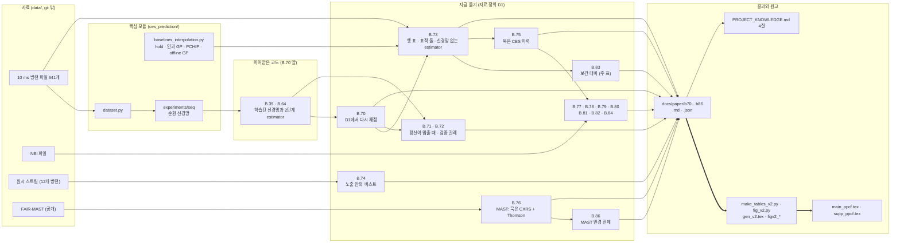

# KSTAR CES nowcasting — pedestal top

B114 COMPLETE / independently audited (2026-11-26): author-authorized overnight localGPU suite, six candidates144fits. PREREGISTRATION_B114.md -> b114_overnight/queue114.py -> CatBoost96 + neural48 -> per-outer-unit VAL selection -> selected TEST predictions -> independent audit114 -> close114 records/commit/push. Human list docs/paper/b114_overnight_plan.md; live docs/paper/b114_status.md and ignored data/.b114/workflow/status.json. GPU boundary08:00KST,CPU audit09:00; no retries/extra fits. Source/data contract common114; producer models114/neural114/cat114; independent selection114. PriorB113complete untouched.

B113 COMPLETE / independently audited (2026-11-26): author-authorized local GPU CatBoost, same audited B112 scalar inputs; PREREGISTRATION_B113.md -> b113_catboost/orchestrate113.py (smoke -> run113.py -> audit113.py) -> docs/paper/b113_comparison.json/md. Preparation/status: docs/paper/b113_status.md; bounded Claude attempt: b113_claude.md via review113.py. Ignored live records data/.b113_workflow/status.json and data/.b113/progress.json. No original batch modified.


KSTAR 2022 캠페인의 pedestal top 측정선에서 CES 이온 온도를, 다음 CES 값을 기다리지 않고 10 ms마다 추정하는(nowcasting) 연구의 코드, 기록, 원고다. 입력은 그 측정선의 CES 이력과 같은 위치의 빠른 진단(BES, ECEI)이다.

> **For readers of the manuscript.** The registrations of the batches are `ces_prediction/experiments/PREREGISTRATION_B{NN}.md`, their results `docs/paper/b{NN}_*.md` and `.json`. Every number of the manuscript is generated from those result files by `docs/paper/ppcf/make_tables_v2.py`. The KSTAR shot files cannot be redistributed; the MAST data are public (FAIR-MAST) and are fetched by `ces_prediction/experiments/mast/fetch_*.py`.

이 문서는 **배선**을 적는다: 무엇이 무엇을 읽고, 어디로 가는가. 어떻게 돌리는가는 `HANDOVER.md`, 무엇을 정했는가는 `PAPER_DESIGN.md`, 무엇이 나왔는가는 `PROJECT_KNOWLEDGE.md`에 있다.

## 1. 연구의 줄기

B112 탐색 비교: `experiments/PREREGISTRATION_B112.md` → `b112_residual/export112.py`의 동일 TX 입력 → `prepare112.py`의 private Colab 노트북 → `run112.py`/`model112.py`의 직접 회귀·GP 잔차 MLP 및 동일 지원 HGB → `stats112.py` → `audit112.py` → `docs/paper/b112_comparison.json/md`. 상태는 `b112_status.md`; 로컬 적합·pytest 없이 Colab T4에서 실행한다.

B112 실제 전달은 addendum3의 `research/prepare_b112_native.py`가 exact payload를 보존한 native Files 업로드 셀을 준비하고, 기존 B111 T4에서 실행한다. `b112_residual/watch112.py`가 지정된 결과 다운로드만 검증·회수해 독립 감사를 호출한다.

B111은 Colab 계산과 독립 CPU 감사를 완료했다. `docs/paper/b111_comparison.json/md` → `PROJECT_KNOWLEDGE.md`의 LSTM 후단 비교 기록으로 읽는다. 실제 전달은 아래 addendum5의 standalone 경로이며, 이전 MCP 감시기는 중복 실행하지 않는다.

B111 proxy독립 전달: `PREREGISTRATION_B111_ADDENDUM5.md` → `research/prepare_b111_standalone.py`가 private 한셀GPU노트북을 생성한다. 원본zip업로드/검증→frozen workflow→정상종료뒤receipt추가·결과다운로드를수행한다. `research/watch_b111_download.py`는지정Downloads/b111_results.zip만receipt검증후private로복사→원래독립CPUaudit한다. 과학코드/학습조건변경이나로컬fit없음.

B111 한 셀 실행: `PREREGISTRATION_B111_ADDENDUM4.md` → `research/prepare_b111_manual.py`가 현재 scratchpad의 소유 셀과 private `COLAB_B111.ipynb`/`COLAB_B111_CELL.py`를 준비한다. Colab 기본 업로드로 정확한 기존zip만 전달·검증한 뒤 frozen controller를 실행한다. `research/wait_b111_manual.py`는 준비 셀의 정확한 source/attempt/SHA launch표지만 읽어 연결하고 기존 observer/audit를 호출한다. 대기 중 kernel실행·학습재시도 없음.

B111 native 전달: `PREREGISTRATION_B111_ADDENDUM3.md`의 Colab 기본 Files 업로드 → `research/launch_uploaded_b111.py`가 실제T4·기존archive SHA·launch부재를 확인해 같은 frozen controller를 시작한다. 기존 MCP 셀 반복전송 실패 기록은 유지하고 입력/학습/통계 조건을 바꾸지 않는다.

B111 전송 응답 복구: `PREREGISTRATION_B111_ADDENDUM1.md` → `research/recover_colab_b111.py`가 원격 실제 prefix SHA·과학 실행 부재를 검사하고 같은 archive를 큰 청크로 이어 보낸다. 원래 전송 상태·요청 이력을 보존하며 frozen scientific code/입력/후단fit 조건은 바꾸지 않는다. large-source 셀을 먼저 짧게 정리한 뒤만 get_cells를 읽는다.

B111 전체 비교: `experiments/PREREGISTRATION_B111.md` → `b111_full_compare/export111.py`가 공유 입력의 원본 bit 일치·20checkpoint·OOF 분리를 확인해 익명 포장한다. Colab `run111.py`가 held 추론→후단8적합→outer8시나리오→`stats111.py`의32셀 MSE/구간을 실행한다. `research/colab_b111_operator.py` 전달/회수, `watch_colab_b111.py` 감시/알림/완료회수→`audit111.py`의 원본features/휴대tree/전체구간 독립검산→`docs/paper/b111_comparison.json/md`. 상태 `b111_status.md`, private `data/colab_b111/`. 로컬GPU/fit/Claude 호출 없음. B106 과학 계약을 B109 selected 모델로 마무리한다.

B110 잔차 분해: `experiments/PREREGISTRATION_B110.md` → `b110_residuals/export110.py`가 완료 LSTM의 D10/F VAL 입력과 저장 TCN/GP 계열 대조를 익명 포장하고, `run110.py`가 Colab에서 추론·편향/중심화 MSE·source-age/이력 변화 층별 재표집 구간을 계산한다. `research/colab_b110_operator.py`가 전달/회수, `b110_residuals/audit110.py`가 별도 산술로 행·점추정·구간을 검산해 `docs/paper/b110_residuals.json/md`를 만든다. 완료·독립검산통과, 다음 순서는 `docs/paper/b110_next_steps.md`와 `HANDOVER.md`. 새 적합/TEST/로컬 GPU/Claude API 없음. VAL 재사용 탐색 진단이며 최종 LSTM 후단 merit 비교는 별도다.

Colab 전송 복구: ces_prediction/research/recover_colab_b109.py는 본 학습 전 원격 작업폴더 소실을 기록하고 같은 archive의 검증된 byte-prefix부터 전달한다. PREREGISTRATION_B109_ADDENDUM2.md에 따른 전송 전용 복구이며 launch 중복 방지·전체 SHA 확인 후에만 기존 frozen trainer를 시작한다. 과학적 학습 재시도나 로컬 GPU 재개는 하지 않는다.

Colab 학습 감시/회수: `ces_prediction/research/watch_colab_b109.py`는 원격 B109 상태만 읽고 알림·완료 archive 회수를 수행하며 학습을 새로 시작/재시도하지 않는다. `research/audit_colab_b109.py`는 회수한 checkpoint/optimizer/history/VAL 산술/정상 종료를 CPU에서 별도 검산해 `docs/paper/b109_fit_audit.json/md`와 private `data/colab_b109/selected_paths.json`(완료20경로)을 만든다. B109_ADDENDUM1이 이 운영 검증을 고정한다. TEST/후단 적합은 포함하지 않는다.

Colab 본 학습 연장: `experiments/PREREGISTRATION_B109.md` → `experiments/b109_colab_train/export109.py`가 중단4/미시작5 경로의 동일 TRAIN/VAL·상태를 익명 private 묶음으로 만들고 `train109.py`가 T4/cuDNN에서 patience6까지 학습한다. 완료11은 유지한다. `research/colab_b109_operator.py`가 공식MCP로 전달·진행 읽기·checkpoint 회수를 수행한다. 상태 `docs/paper/b109_status.md`, private `data/colab_b109/`; 로컬GPU재개/TEST/후단새적합은 없다.

Colab T4 측정 결과: `ces_prediction/research/audit_colab_b108.py`가 회수한 private `data/colab_b108/b108_colab_results.zip`의 모든 child 종료 기록과 시간 구간을 별도로 검산해 `docs/paper/b108_results.json/md`를 생성한다. 짧은 실제 배치 처리량 결과이며 본 학습/MSE·로컬 대비 정확한 배수는 아니다.

Colab 직접 전달: `ces_prediction/research/colab_t4_operator.py`가 공식 MCP 브리지로 실제 T4 확인 → B108 private zip 분할 전달/해시 검증 → 원격 timing controller 실행 → aggregate 결과 회수를 수행한다. `PREREGISTRATION_B108_ADDENDUM1.md`가 수동 업로드를 대체하는 전달 범위를 고정한다. 로컬 GPU 학습 재개 없이 `check/start/poll`; 상태는 ignored `.colab_connection/b108_remote.json`·`b108_progress.json`.

Colab T4 준비: `experiments/PREREGISTRATION_B108.md` → `experiments/b108_colab/export108.py`가 실자료 TRAIN/VAL·고정 가중치로 비공개 실행 묶음과 노트북을 만든다. `portable108.py` 원분기/목적함수 CPU 대조 후 `probe108.py`/`run108.py`로 1/4병렬 cuDNN/native 경로의 짧은 속도·정상 종료만 확인한다. 새 MSE/모델 선정이 아니다. `ces_prediction/research/colab_mcp_bridge.py`는 공식 Colab MCP를 분리된 도구 환경에서 호스팅해 직접 노트북 전달을 연결한다. 연결/사용법 `docs/paper/b108_colab.md`, private 결과 `data/colab_b108/`, 연결 상태 `data/.colab_connection/`. `.env`/계정 키/TEST 데이터 미포함, 로컬 GPU 학습 재개 없음.

Reader model names: `ces_prediction/research/thesis_reader/model_names.py` supplies separate GP/TCN display namespaces to `integrate_longform.py` and `build_reader.py`. The methods mapping table and each original exhibit's legend distinguish GP-Boost-CES/GP-Boost-Multi from TCN-CES/TCN-Multi while preserving frozen keys and original PDFs. `audit_model_names.py` checks unchanged numerical/citation content, retained scientific sources and UI → `docs/paper/research_reader/model_naming.json`. `PAPER_DESIGN.md` records the author-approved display-name convention.

로컬 실험 일시 중단(2026-11-24): 저자 지시 → `ces_prediction/research/stop_local_b107_20261124.py`가 B107 프로세스 신원과 검증 checkpoint를 확인하고 상태를 보존한 뒤 학습/큐를 중단했다. 증거 ignored `data/.b107/author_stop.json`, 재개용 checkpoint·이력 `.b107/author_stop_20261124_1244/`; 상태 `docs/paper/b107_status.md`. 자동 재개하지 않으며 Colab 실행은 아직 시작하지 않았다.

B.107 학습 연장: `experiments/PREREGISTRATION_B107.md` → `experiments/b107_patience/pipeline107.py`가 기존 B106 GPU child를 유지하며 대기열을 인수하고, 시간 제한 경로는 optimizer/scheduler/검증 이력을 복원해 patience6까지 잇는다. 미시작 경로도 같은 종료 기준을 적용하며, 모두 충족한 checkpoint만 기존 B106 추론·OOF 후단·동일행 MSE·독립 audit에 연결한다. 상태 `docs/paper/b107_status.md`, 결과 `b107_lstm.json/md`, ignored 근거 `data/.b107/`; 새 Claude/API 호출 없음. 원래 난수 상태 미저장으로 dropout bitwise 재현은 주장하지 않는다.

B.106 LSTM 비교: `experiments/PREREGISTRATION_B106.md` → `experiments/b106_lstm/pipeline106.py`가 원래 SeqCESLSTMv2 온도 경로의 전체/OOF20학습과 15특징 후단 보정 두 정책을 학습한다. 같은 F 평가 행에서 GP+fast/이력-only 부스팅·GP·hold·저장 TCN의 MSE를 먼저 비교하고 독립 audit 뒤 `docs/paper/b106_lstm.json/md`를 게시한다. 상태 `b106_status.md`, 근거 ignored `data/.b106/`; Claude API 호출 없음. 후보 선정의 한계와 기여 방향은 `docs/paper/research_direction_after_tcn_20261124.md`.

TCN MSE 원인 분석: `ces_prediction/research/b105_cause_review_20261124.py`는 기존 B105 집계·학습 곡선·코드만 공식 Fable 상세 분석과 Opus 독립 반론에 제공해 `docs/paper/b105_cause_review_20261124.md`를 만든다. 보고서 앞의 작업자 교정이 모델 원문보다 우선하며 G=GP/GRU namespace 혼동과 행/군집 가중을 바로잡았다. 새 적합·잔차 채점·TEST 선택은 없고 후속 진단은 미실행이다.

B.105 실행: `experiments/PREREGISTRATION_B105.md` → `experiments/b105_merit/pipeline105.py`가 새35채널 TCN·동일 내부 TRAIN 회귀기·공통 VAL 게이트·조건부 TEST·독립 audit를 실행한다. 모델/학습 adapter·CPU 회귀기·실자료 검사·예측·통계·독립 검산·로컬 감시가 같은 폴더에 있고, `research/review_b105.py`가 제한된 공식 Fable 검토를 연결한다. 상태 `docs/paper/b105_status.md`, 최종 `b105_merit.json/md`, `b105_claude.md`, ignored 근거 `data/.b105/`. 기존 동결 코드/결과는 보존한다.

최신 학습 방향: `docs/paper/tcn_merit_plan_20261124.md`는 저자의 지시에 따라 TCN의 현행 estimator 대비 merit를 먼저 판정한다. 아래 P1/Stage0는 후순위다. `ces_prediction/research/tcn_merit_plan_20261124.py` → 제한된 공식 Fable 검토·사용량 기록 `docs/paper/tcn_merit_fable_20261124.md`; `ces_prediction/research/render_tcn_merit_20261124.py` → 기존 B94 JSON의 paired 비교 전체 표와 idx/mask만 읽은 재사용 목록 `docs/paper/tcn_merit_existing_20261124.md`. 새 적합/TEST 채점은 없으며 조건부 GPU 계획은 실행 등록 전이다.

심화 조사 반영: `docs/paper/fable_deep_review/DECISION.md`·마지막 지연측정 부록 → `docs/paper/stage0_anchor_program_DRAFT.md`의 metadata-only 사전등록 준비 계약. B.104는 그대로 완료하고, 후속 P1은 CES 이력/NBI를 조건으로 한 fast 증분을 작은 source-time 추정기로 분리한다. 초안은 새 적합/TEST 재채점 허가가 아니며 실제 실행 전 별도 등록이 필요하다. 현재 우선순위는 `HANDOVER.md`에서 읽는다.

B.104 후속 예산 실험 준비: `experiments/PREREGISTRATION_B104.md` → `experiments/b104_budget/`가 기존 TRAIN/VAL 곡선·Claude 검토를 바탕으로 동일 새 trajectory의 SHORT/LONG을 비교한다. 원래 B.94 결과와 코드는 보존한다. 현재 준비/실행 상태는 `docs/paper/b104_status.md`, 검토·실행 기록은 `data/.b104/`이며 GPU 전 사전등록 커밋·실제 smoke·독립 코드 검토가 필수다.

Claude 초안 lead 검토: `research/posteval_lead/PLAN.md` → 같은 폴더 `review.py`가 독립 검산 gate·동결 코드의 skill/가용 규칙 정의를 짧게 제공하고 기존 초안을 보완 → `docs/paper/posteval_lead_review_20261123.md/json`. 원래 초안과 수치는 보존하며 기존16 substantive call 한도 안에서 최대4회 추가, 새 통계·학습은 없다. 기록 `data/.claude_posteval_lead_20261123/`.

B.103 게시 마무리: `experiments/PREREGISTRATION_B103.md`·B.94 addendum8 → `experiments/b103_publish/publish103.py`가 이미 통과한 최종 감사 hash를 재확인하고 methods JSON/md 두 파일만 게시 → 원래 Claude gate. `watch103.py`는 기존 감시기를 새 task에만 process-local 연결한다. 원래 보조 readiness 문서는 그대로 두며 재학습/예측/통계 계산은 없다. 기록 `data/.b103/`, 현황 `HANDOVER.md`.

B.102 마지막 검사 복구·알림: `experiments/PREREGISTRATION_B102.md`·B.94 addendum7 → `experiments/b102_postcheck/finish102.py`가 기존 계산을 재생성하지 않고 Windows manifest key를 메모리에서 정규화·산출물 보존 검사 → 원래 post audit → Claude gate. 같은 폴더 `watch102.py`는15초마다 생존/단계를 확인해 즉시·5분 간격 로컬 cvmux 알림과 한정된 평가 중단 복구를 담당한다. 상태·알림 기록은 `data/.b102/`, 인수인계는 `HANDOVER.md`.

B.101 집계 복구: `experiments/PREREGISTRATION_B101.md`·`PREREGISTRATION_B94_ADDENDUM6.md` → `experiments/b101_readout_repair/repair101.py`가 실패 원본·368예측 hash 보존 후 TX 신경망/회귀기 key 충돌만 복구 → 원래 renderer/post audit → 기존 Claude gate. 기록은 `data/.b101/`, 상태는 `docs/paper/b94_status.md`·`HANDOVER.md`. 새 학습/예측은 없다.

운영 복구 배선: `ces_prediction/experiments/PREREGISTRATION_B100.md`와 `PREREGISTRATION_B94_ADDENDUM5.md` → `b100_eval_resume/resume100.py`가 재부팅 후 완료 fit·예측 hash를 재검증하고 중단 묶음만 원래 predictor로 계산 → 원래 readout/post audit → 기존 `research/posteval_claude/worker.py`. 기록은 `data/.b100/`, 현재 상태는 `docs/paper/b94_status.md`와 `HANDOVER.md`에서 읽는다. 새 학습은 하지 않는다.

저자의 틀: pedestal top에서의 nowcasting 문제를 푼다. 보간법 등에 견주어 가장 좋은 모델을 찾는다. 지금 가진 자원으로 10 ms 실시간이 되어야 하고, 적용했을 때 더 잘 작동함을 보이면 더 좋다.

| 질문 | 재는 배치 | 원고의 절 | 기록 (`PROJECT_KNOWLEDGE.md`) |
|---|---|---|---|
| 1. 어느 estimator가 가장 좋은가 (hold, 인과 GP, 다음 값을 기다리는 PCHIP·offline GP 대비) | B.83, B.73, B.70 | 결과 4.1 | 4.68절, 4.54절, 4.48절 |
| 2. 빠른 진단이 CES 이력에 더하는 것 | B.73, B.79, B.81, B.82 | 결과 4.2 | 4.54절, 4.61절, 4.65절, 4.66절 |
| 3. 방전을 달리 나눠도, 시간 순으로도, 실시간으로 | B.72, B.73, B.75 | 결과 4.3 | 4.51절, 4.54절, 4.55절 |
| 4. 적용했을 때: CES가 늦거나 드물 때, 둘째 장치 | B.75, B.78, B.77, B.84, B.71, B.76, B.86 | 결과 4.4, 4.5 | 4.55절, 4.58절, 4.57절, 4.69절, 4.49절, 4.59절, 4.71절 |
| 5. 성립하지 않는 곳 | B.75(마지막 블록), B.80, B.82, B.84 | 결과 4.6, 고찰 | 4.62–4.64절, 4.66절, 4.69절 |

논문의 estimator는 신경망이 아니다: 과거 CES 값에 대한 인과 Gaussian process 위에, CES 이력의 스칼라와 빠른 진단의 스칼라를 읽는 boosted regression을 얹은 것이다. 순환 신경망과 그 2단계 estimator는 비교 행이다.

## 2. 배선도

| 실행 경로 | 읽는 것 → 만드는 것 | 사용처 |
|---|---|---|
| `research/claude_lean_scout_20261123.py` | 개인/원자료/성능을 제거한 방법 계약 + 공식 Claude 모델 → 세 독립 검토·반대 검토 | `docs/paper/claude_lean_reviews_20261123.md`, Lean/이론 적용 검토; 학습 코드와 TEST 선택에 영향 없음 |
| `research/claude_lean_bridge_20261123.py` | 공개 TorchLean/형식 검증 자료 + 같은 비식별 방법 계약 → 실제 연산자·실행 의미 연결 검토 | `.claude_lean_20261123/torchlean_bridge.json`, 최종 Lean 적용 판단 |
| `research/claude_lean_math_audit_20261123.py` | 검토 중 발견한 OU/hold 식·정보집합·마스킹 식별의 반례 → Opus 독립 수학 검산 | `.claude_lean_20261123/mathematical_audit.json`, 검증 전 제안과 수정된 정리 구별 |
| `research/check_lean_candidate_algebra_20261123.py` | 명시된 확률모형의 공분산·미분 항등식 → 정확한 SymPy 기호 검산, 관측 생성 없음 | `.claude_lean_20261123/algebra_checks.json`, 아래 Lean 판단 문서가 해석; Lean 증명이 아님 |
| `research/claude_physics_scout_20261123.py` | 비식별 계측·자료 계약 → CES/BES/ECEI forward model, 에너지 응답, pedestal 변위의 세 Claude 검토와 반대 선택 | `data/.claude_physics_20261123/`, `docs/paper/physics_formulations_20261123.md`; 새 학습/TEST 분석 아님 |
| `research/claude_physics_math_audit_20261123.py` | 저차 강제 응답·노출 평균·L5 중앙값 해석의 구체 식 → Opus 재검산 | 같은 local cache, 물리 접근 판단 문서의 정정과 최종 식 |
| `research/check_physics_formulations_20261123.py` | 명시한 ODE·OU 노출 평균·스펙트럼 혼합의 기호 변수 → 정확한 항등식 검산 | 같은 local cache의 `algebra_checks.json`, 물리 접근 판단 문서; 관측 생성·모형 적합 없음 |
| `experiments/PREREGISTRATION_B98.md` | 저자의 수식 모형 구현 지시 → 다섯 계수 완화식·이력/정적 대조의 고정 TRAIN/VAL pilot | `experiments/b98_physics/`, `docs/paper/b98_physics.*`; 기존 GPU/TEST와 분리 |
| `experiments/b98_physics/{data98,model98,run98}.py`, `lead_checks/{recurrence98,readout98}.py` | 기존 train-only 준비 자료·B.79 power → 제한된 수식 모형 적합·직접 재귀/비간섭 검사·shot-cluster 판독 | `data/.b98/`, `docs/paper/b98_physics.json`; F 내부 VAL 개발 증거 |
| `experiments/b98_physics/review98.py` | 등록 및 비식별 구현 소스만 Claude Fable에 전송 → 적합 전 수식/검증 반대 검토 | `data/.b98/review/`, `docs/paper/b98_lead_checks.md`; 실제 배열 전송 없음 |
| `experiments/b98_physics/lead_checks/input98.py` | 원래 grid·준비 artifact를 별도로 읽어 source/공통 행/채널 mapping 재구성 | `readout98.py`의 독립 raw-data 검사; 실제 수치모형 helper와 분리 |
| `research/report_b98_20261123.py` | 독립 판독된 `docs/paper/b98_physics.json` → 네 대표 unit·모든 규칙의 수치 표 | `b98_physics.md`, `b98_lead_checks.md`; 내부 VAL·군집 중복·물리 식별 한계 명시 |
| `research/posteval_claude/PLAN.md` | 저자의 Claude 기본 연동·평가 후 agentic 연구 정리 지시 → 최종 감사 gate와 제한된 API 도구 계약 | 같은 폴더의 worker/agent, `docs/paper/posteval_claude_20261123.*`; 기존 평가·새 학습 실행과 분리 |
| `research/posteval_claude/{evidence,agent,worker,check_setup}.py` | 최종 정상 종료+감사 hash gate → 익명 집계만 읽는 Claude4단계 도구 loop → 근거표·연구 초안 | `data/.claude_posteval_20261123/`, 위 보고서·후속 연구 draft; 현재 평가와 수치 코드 불변 |
| `docs/paper/posteval_claude_20261123_status.md` | 실제 API tool-use 시험·숨김 작업 등록 → 대기/완료 조건과 산출물 안내 | `HANDOVER.md`, 다음 agent가 live 상태와 후속 연구 초안을 확인하는 진입점 |
| `experiments/PREREGISTRATION_B99.md`, `PREREGISTRATION_B94_ADDENDUM4.md` | 저자의 GPU 재개 지시 → 실패 보존·metadata 감독기 보완·원래4-slot 큐 재개 계약 | `experiments/b99_recovery/`, `docs/paper/b99_recovery.*`; 동결 수치 코드/마감 불변 |
| `experiments/b99_recovery/{monitor99,probe99,recover99}.py`, `lead_checks/verify99.py` | 실제 Windows metadata lock 점검 + 완료 fit/동결 소스 검사 → 네 partial 보존·한정 재시작 | `data/.b99/`, `data/.b94/interrupted_permission99/`, 같은 결과 문서 |
| `docs/paper/lean_feasibility_20261123.md` | Claude 검토 여섯 건 + 원천 문헌 + 현재 모델 코드 + 기호 검산 → 적용 우선순위와 반례 | `HANDOVER.md`, 현재 논문의 방법/검증 검토; 등록된 학습과 TEST 선택은 변경하지 않음 |
| `experiments/PREREGISTRATION_B97.md` | 저자의 Lean 실행 지시 → 선택기 증명·고정 TRAIN/VAL trace 비교의 사전 계약 | `formal/visibility/`, `experiments/b97_lean/`, `docs/paper/b97_lean.*`; 학습·TEST 점수와 분리 |
| `formal/visibility/{Visibility,Main}.lean`, `lakefile.toml`, `lean-toolchain` | 이산 latest-visible 명세 → Lean 증명 및 같은 선택기의 local stdin 실행 | `experiments/b97_lean/run97.py`, 공리 감사와 실제 trace 연결 검사 |
| `experiments/b97_lean/toolchain97.py`, `run97.py`, `lead_checks/verify97.py` | 고정 SHA 공식 Lean 배포본 + 등록 TRAIN/VAL trace → 컴파일·선택기 비교·독립 재계산 | `data/.b97/`, `docs/paper/b97_lean.json`, `formal/visibility/README.md` 실행 설명 |
| `experiments/b97_lean/review97.py` | 비식별 Lean/bridge 소스만 Claude Fable에 전송 → 구현 반대 검토 | `data/.b97/claude_review.json`, `docs/paper/b97_lean_checks.md`에서 판정; 실제 자료 전송 없음 |
| `experiments/b97_lean/lead_checks/verify97_paths.py` | B.97 부록1의 Windows/POSIX 경로 키 정규화 → 원래 독립 검증기를 변경 없이 실행 | `docs/paper/b97_lean.json`의 adapter hash와 첫 실패 보존 기록 |
| `experiments/b96_four/common96.py`, `transition96.py` | 저자 선택4개 + 기존 정상4-worker 증거 + 생존 프로세스 생성 시각 → 손실 없는 배정 전환 | 기존 trainer 정상 종료·종료 증거를 보존한 뒤 새 durable task 실행 |
| `experiments/b96_four/production96.py` → `bootstrap96.py` | 동결 B.94 scheduler/학습 + 과거95 provenance → 전역4개 배정·새96 provenance | 완료 fit 재사용, `.b94/dispatch_policy96.json` |
| `docs/paper/b96_four.{md,json}` | B.95 실측 + B.96 정책·정상 종료 전환 증거 → 저자 선택4개와 학습 보존 기록 | 최신 운영 선택과 전역/로컬 worker 수 구별 |
| `experiments/b95_concurrency/profile95.py` | 등록 B.95 + 동결 B.93 실제 epoch worker → `data/.b95/` 동시2/3/4 및 조건부6 작업의 전체 처리량 | 메모리 여유와 실제 가속을 구별한 실행 정책 선택; 예측 성능 근거 아님 |
| `experiments/b95_concurrency/audit95.py`, `common95.py` | 전체 cohort 원자료·SHA·전역/그룹 slot → 독립 처리량 및 실행 출처 검증 | B.95 선택과 새 fit의 추가 metadata 감사 |
| `experiments/b95_concurrency/tie95.py` | B.95 부록1 + 원 결정 → 4-worker의 추가 실제 전체 cohort | 5% 이내 동률에서 더 적은 worker를 선택하기 위한 제한된 반복 확인 |
| `experiments/b95_concurrency/report95.py` | B.95 전체 cohort·독립 감사·불필요한 추가 실험 취소 증거 → `docs/paper/b95_concurrency.{md,json}` | 메모리 실행 가능성과 실제 처리량의 차이 및 선택 근거 |
| `experiments/b95_concurrency/production95.py` → `bootstrap95.py` | B.94 동결 scheduler/학습 함수 + B.95 적격 수 → 전역 병렬 배정, `data/.b94/dispatch_policy95.json` | B.94 부록3; 기존 완료 fit 재사용, 수치 코드 수정 없음 |
| `docs/paper/claim_robustness_20261123.md` | B.73–B.87 결과 JSON + 논문 설계 + 선행 연구 → 주장별 근거·반대 증거·추가 검증 조건 | 원고 검토 및 후속 실험의 주장 범위; 진행 중 NN 성능 근거 아님 |
| `experiments/b93_gpu/profile93.py` → `worker93.py` | 등록 B.93 + B.92 실제 준비 자료/모델 → `data/.b93/` 전체 epoch 및 동시 실행 적격성 기록 | 별도 GPU 실행 개정의 사전 감사; 예측 성능 근거 아님 |
| `experiments/b93_gpu/durable93.py`, `status93.py` | 정확한 PID·생성 시각 + 원래 마감 시각 → 생존 확인·heartbeat | `docs/paper/b93_supervisor.md`, 실행 상태 보고 |
| `experiments/b93_gpu/atomic93.py`, `lead_checks/probe_atomic93.py` | 실제 Windows 공유 잠금·timestamp 전용 자료 → bounded atomic JSON 저장 및 OS 잠금 검증 | B.94·durable 상태 저장; 모델 학습 재시도 없음 |
| `experiments/b93_gpu/lead_checks/verify93.py` | 실제 배열·초기 가중치·모든 runtime/exit 원자료 → 독립 적격성 감사 | `docs/paper/b93_lead_checks.md`, B.94 실행 전 확인 |
| `experiments/b94_parallel/common94.py`, `runtime94.py`, `adapter94.py` | 동결 B.92 학습 루프 + B.93 감사·선택 → 격리된 GPU 실행·출처·캐시 | B.94 새 프로세스만 적용; B.92 수정 없음 |
| `experiments/b94_parallel/scheduler94.py` → `bootstrap94.py` | 등록 B.94 + 검증된 worker 개수 → smoke·pilot·선택·조건부 confirmation·readout | `data/.b94/`, 감사 후에만 `docs/paper/b94_*`로 출력 |
| `experiments/b94_parallel/lead_checks/` | B.94 원자료·선택·출력 및 원래 마감 → pre/prepared/pilot/post 감사 | scheduler의 단계별 필수 gate |

화살표는 "읽는다 → 만든다"의 방향이다. 굵은 테두리가 원고로 들어가는 길이다.



## 3. 노드

### 3.1 자료와 캐시 (git 밖)

| 노드 | 무엇 | 누가 읽는가 |
|---|---|---|
| `data/s{shot}.csv` | 10 ms 방전 파일: 시각, CES T_i·V_rot, BES 9, ECEI 4, Mirnov 2 | `dataset.py`, `seq/seq_data.py`, B.73의 행 표 |
| `data/nbi/` | 빔 source별 출력과 전압 | `analyze_nbi_files.py`, B.79 |
| `data/raw_mus/` | 12개 방전의 원시 스트림 | `analyze_file_rules.py`, B.74 |
| `data/mast/` | 공개 FAIR-MAST 자료 | `experiments/mast/`, B.76, B.86 |
| `data/.b70` … `data/.b86` | 배치별 캐시(행 표, 입력, 저장된 추정) | 뒤의 배치, `make_tables_v2.py`, `fig_v2.py` |

### 3.2 핵심 모듈

| 노드 | 무엇 | 누가 읽는가 |
|---|---|---|
| `ces_prediction/dataset.py` | 파일 읽기, 유지값과 3 keV 처리, 정규화, 자료 계약 | `seq/seq_data.py`, `train.py`, 시험 |
| `ces_prediction/baselines_interpolation.py` | hold, 인과 GP, PCHIP, offline GP | B.73, B.75, B.76, B.78, B.83, `seq/eval_seq.py` |
| `ces_prediction/experiments/seq/` | 순환 신경망(`model_seq_v2.py`)과 학습·채점 | 이어받은 학습(B.39, B.64), B.70, B.73, B.83(`seq_data.py`) |
| `ces_prediction/model.py`, `model_iter009.py`, `train.py`, `evaluate.py` | 핵심 파이프라인의 윈도 모델. 논문에는 쓰이지 않는다. 자료 계약과 그 시험을 위해 있다 | `tests/test_architecture.py` |
| `ces_prediction/analyze_file_rules.py`, `analyze_nbi_files.py` | 파일의 규칙, NBI 파일의 사실 | `docs/paper/file_rules.md`, `nbi_files.md` → 원고의 자료 절 |

### 3.3 지금 줄기의 배치 (자료 정의 D1)

디렉터리는 `ces_prediction/experiments/` 아래, 결과는 `docs/paper/` 아래다.

| 배치 | 묻는 것 | 읽는 것 | 내는 것 | 누가 읽는가 |
|---|---|---|---|---|
| B.70 `b70_d1/` | 자료 정의 하나(D1)에서 신경망과 2단계 estimator | 저장된 학습(B.39, B.64 등), 방전 파일 | `data/.b70*`, `b70_d1.*`, `dataset_ledger.md` | B.73, B.71, B.72 |
| B.71 `b71_scenarios/` | CES 갱신이 멈출 때 | 저장된 학습, B.70 | `b71_scenarios.*` | 원고(쓰임), 기록 4.49절 |
| B.72 `b72_methods/` | 같은 결과를 다른 검증 관례로 | B.70 | `b72_methods.*` | 기록 4.51절 (검증 설계 넷의 근거) |
| B.73 `b73_targets/` | 표적 둘, 검증 설계 넷, 신경망 없는 estimator | 방전 파일, `data/.b70`, 인과 GP | `data/.b73/` (행 표, 격자, fit), `b73_targets.*` | B.75, B.77, B.78, B.81–B.84, 원고의 주 표 |
| B.74 `b74_exposure/` | 한 프레임만 튀는 값의 노출 안에 무엇이 있는가 | 원시 BES | `b74_exposure.*` | 원고(자료 절) |
| B.75 `b75_availability/` | CES 이력이 묵었을 때(가용 규칙별) | `data/.b73` | `data/.b75/` (규칙별 입력, fit), `b75_availability.*`, `b75_last_block.md`, `b75_stuck_ecei.md` | B.77–B.82, B.84, 원고(쓰임, 한계) |
| B.76 `b76_mast_availability/` | MAST: 묵은 CXRS 이력과 지금의 Thomson | `data/mast/`, `mast/` | `data/.b76/`, `b76_mast_availability.*` | B.86, 원고(MAST) |
| B.77 `b77_correct/` | 프레임의 값을 읽은 뒤의 보정 | `data/.b73`, `data/.b75` | `b77_correct.*` | 원고(쓰임) |
| B.78 `b78_sparse/` | CES 값이 k번째 프레임마다 | `data/.b73`, `data/.b75` | `data/.b78/`, `b78_sparse.*` | B.81, B.82, B.84, 원고(쓰임) |
| B.79 `b79_beam_inputs/` | 빔 파형을 다 준 뒤에도 증분이 남는가 | `data/.b75`, `data/nbi/` | `data/.b79/`, `b79_beam_inputs.*` | B.82, 원고(빠른 진단) |
| B.80 `b80_ecei_gate/` | ECEI 채널의 상관이 마지막 블록을 설명하는가 | `data/.b75` | `b80_ecei_gate.*` | 원고(한계) |
| B.81 `b81_controls/` | 대조 둘(섞은 입력, anchor 행 입력), ECEI만·BES만 | `data/.b75` | `data/.b81/`, `b81_controls.*` | B.82, 원고(빠른 진단) |
| B.82 `b82_localize/` | notch 뒤 경과 시간별, 견고한 지표, Mirnov 대조, seed | `data/.b75`, `data/.b79`, `data/.b81` | `data/.b82/`, `b82_localize.*` | B.83, B.84(구간 코드), 원고(빠른 진단, 견고한 지표) |
| B.83 `b83_interp/` | 다음 값을 기다리는 보간 대비 | `data/.b73`, `data/.b70`(신경망의 행), 방전 파일 | `data/.b83/`, `b83_interp.*` | 원고의 주 표 |
| B.84 `b84_onefit/` | 2차 estimator가 조건에 묶여 있는가 | `data/.b75`, `data/.b78` | `data/.b84/`, `b84_onefit.*` | 원고(쓰임, 한계) |
| B.86 `b86_mast_radius/` | MAST에서 중심부터 가장자리까지 | `data/.b76`, `data/mast/` | `data/.b86/`, `b86_mast_radius.*` | 기록 4.71절, 원고(MAST) |

B.85는 가용 조건을 섞어 학습한 직접 출력 순환 신경망(GPU)이다. 등록·구현·정상 종료 smoke를 마치고 본 배치를 실행 중이다(`HANDOVER.md` 9.1절, `PREREGISTRATION_B85.md`와 부록).

### 3.4 이어받은 코드 (B.70 앞)

지금 줄기의 코드가 import하거나, 그 학습 결과를 B.70이 다시 채점하거나, 2026-11-19의 발표 그림이 읽는 배치 33개다(`b1_gate`, `b27`, `b29`–`b34`, `b37`–`b39`, `b41`, `b42`, `b44`, `b45`, `b48`, `b50`, `b54`–`b62`, `b64`–`b69`). 등록 파일과 결과 파일은 그대로 있다. **수치는 인용하지 않는다**: D1의 판독(B.70)이 대체한다. 디렉터리별로 누가 import하는지는 `ces_prediction/experiments/README.md`의 "Inherited code" 표에 있다.

### 3.5 원고

| 노드 | 읽는 것 | 내는 것 |
|---|---|---|
| `docs/paper/ppcf/make_tables_v2.py` | B.73–B.84의 `.json`, `data/.b73`, `.b75`, `.b79`, `.b81`, `.b82`, `.b83` | `gen_v2.tex` (표와 수치 매크로), `gen_v2_tokens.json`, `gen_v2_README.md` |
| `docs/paper/ppcf/fig_v2.py` | 같은 결과 파일과 캐시 | `figv2_*` |
| `docs/paper/ppcf/make_supp_fragment.py` | `earlier_line/supp_ppcf_ea2e1a6.tex` (얼려 둔 이전 원고의 자료 절) | `supp_data_fragment.tex` |
| `docs/paper/ppcf/main_ppcf.tex`, `supp_ppcf.tex` | `gen_v2.tex`, `figv2_*`, `supp_data_fragment.tex`, `refs.bib`, `fig_geometry`·`fig_rows`(`fig_paper.py`) | `main_ppcf.pdf`, `supp_ppcf.pdf` |
| `docs/paper/ppcf/check_numbers_v2.py` | 원고와 결과 `.md` | 손으로 친 수치가 출처에 있는지 |

### 3.6 기록

| 노드 | 담는 것 | 검사 |
|---|---|---|
| `PAPER_DESIGN.md` | 목적과 질문, 용어, 자료 정의, 표적, estimator, 검증 설계, 서술 규칙, 논문 지도 | `ces_prediction/check_records.py` |
| `PROJECT_KNOWLEDGE.md` | 자료 사실, 배치마다 한 소절의 결과(4.48절부터), 규칙 | `ces_prediction/check_records.py` |
| `THESIS_RESULTS.md` | 시간순 기록 (B.70부터) | |
| `ces_prediction/experiments/README.md` | 배치 디렉터리와 상태, 이어받은 코드의 사용처 | |
| `docs/paper/review_loop/` | 2026-11-20의 비판 넷, 독립 채점 16–18차, 고정 채점 지시문 | |
| `HANDOVER.md`, `AGENTS.md`, `CLAUDE.md` | 인수인계, 다른 에이전트용 요약, 프로젝트 지침 | |

### 3.7 발표 자료

`docs/presentation/`에 2026-11-19 판의 발표 덱·포스터 빌더가 있다. 그날의 줄기(순환 신경망과 2단계 estimator)로 만든 것이고, 이어받은 배치의 결과 파일(B.39, B.48, B.54–B.58, B.60, B.62, B.64–B.66)과 `docs/paper/ppcf/fig_paper.py`, `fig_trace_causal.py`를 읽는다. 지금 원고에 맞춘 갱신은 저자가 정한다.

### 3.8 방법 후보의 문헌 조사

`ces_prediction/research/claude_method_scout_20261122.py`는 저자가 요청한 Claude API 기반 방법 탐색을 수행한다. 비식별 방법 설명만 전송하고 web search 질의·출처·모델·사용량·응답을 `data/.method_scout_20261122/`에 보존한다. 결과는 `docs/paper/method_scout_claude_20261122.md`; 우선순위와 따로 확인한 원천 문헌은 `docs/paper/method_selection_20261122.md`가 읽는다. 이 조사는 학습 실험이 아니며 B.85 학습 코드나 실행 조건을 바꾸지 않는다. 새 실험은 별도 사전등록 후에만 실행한다. `HANDOVER.md`가 이 후보 목록을 다음 설계에 연결한다.

### 3.9 Fable 학습 가속·후보 축소와 현재 실행

2026-11-23 저자의 요청으로 이전 B.89→B.88→B.90 전체 큐를 대체했다. `research/fable_efficiency_20261123.py`는 실제 `claude-fable-5-2` API로 학습 효율/후보 축소를 따로 검토했고, 정확한 최종 응답은 `docs/paper/fable_efficiency_20261123.md`, 채택·수정·토큰 사용·한계는 `efficiency_decision_20261123.md`가 읽는다. `candidate_reduction_notes_20261123.md`는 그 이전 대안이며 현재 규칙은 아니다.

현재 배선: B.85 부록4와 `b91_fast/checkpoint_stop91.py` → source/RNG가 확인된 partial checkpoint 보존 및 기존 연구 작업만 중단 → `runtime91.py`가 `probe91.py`/`validation91.py`로 일곱 CPU/CUDA 경로와 정상 종료를 실측 → `.b91/runtime_decision.json` → B.92 축소 학습이다. `b91_fast/lead_checks/verify91.py`는 독립 float64 연산/gradient·NumPy 목적함수를, `verify_runtime_outputs91.py`는 전체 실행·종료 해시·타이밍 중앙값·검증 집계를 대조하며 `docs/paper/b91_*`가 결과를 읽는다. 기존 네 clean fit와 중단 checkpoint는 그대로 보존한다.

`b92_reduced/{common92,runtime92,model92,prepare92,train92,run92,queue92,select92,predict92,readout92,checks92}.py`는 고정 의존 소스→실측 runtime→실제 train/val cache→기한 있는 학습·exit 검증→validation 선택→완료 뒤 추론·판독을 연결한다. Pilot C/A/T 세 구성의 열두 fit만 먼저 실행하고, 조건을 채운 한 pair만 최대 마흔여섯 fit 추가한다. 전체15unit·한 seed와 고정 네 unit·세 seed의 구간은 분리한다. `lead_checks/{verify92,verify_bootstrap92,verify_outputs92}.py`는 별도 모델/loss·재표집·완료 산출물 검증이며 `docs/paper/b92_*`가 읽는다. source pins는 `frozen_sources92.json`, 캐시/체크포인트/실행 상태는 ignored `data/.b92/`, 현재 상태 문서는 `b92_status.md`다. 테스트 성능으로 선택하거나 원고를 자동 교체하지 않는다.

실제 dropout.1 CUDA smoke는 종료 충돌로 실패했으며 pilot은 시작하지 않았다. B.92 부록2가 그 결과를 보존하고 **CPU dense MKLDNN8**의 새 실행 경로를 등록했다. `lead_checks/verify_override92.py`가 원 실측·실패·정상 종료 해시와 non-cuDNN 선택을 독립 검증한다. 현재 캐시와 상태는 `data/.b92/cpu_r2/`, 명시적 runtime 기록은 `data/.b92/production_override_r2.json`이다. 실패한 원 `.b92/smoke/`와 immutable B.91 결정은 변경하지 않는다.

## 4. 다시 만드는 순서

연구 방향 검토: [`docs/paper/research_direction_20261122.md`](docs/paper/research_direction_20261122.md)는 현 원고·D1 결과·공개 선행연구를 읽고 다음 실험의 선택 근거를 정리한다. `HANDOVER.md` 9절과 B.87 등록이 이를 읽는다.

| 배치 | 읽는 것 | 만드는 것 | 누가 읽는가 |
|---|---|---|---|
| B.87 `b87_latency/` | B.73 rows/grid, 동일 회귀기·분할, B.87 등록·부록 | `data/.b87/`, `docs/paper/b87_latency.{md,json}`, checks, lead checks; `plot87.py`가 JSON에서 png/pdf 생성 | 연구 방향 검토, 기록; 독립 검증 완료, 원고 반영 전 |
| B.85 `b85_unified/` | B.73 D1 grid/rows·분할, B.75/B.78 가용 규칙·비교 추정, B.84 비교 추정, B.85 등록·부록 | `data/.b85/`의 manifest·GPU checkpoint·예측·상태, `docs/paper/b85_*` readiness/smoke/status/독립 검사; 전체 완료 후 scientific readout | `run85.py`가 입력 검사→GPU 학습→예측→판독을 연결, HANDOVER가 재개·상태를 안내 |
| B.88 `b88_anchor/` | 고정 B.85 입력·학습 코드, 원래 측정 시점의 anchor 빠른 진단, 등록·source pins | `data/.b88/`, `docs/paper/b88_*` 입력·독립 bootstrap 검사와 상태, 완료 후 paired A/C 판독 | 아래 통합 대기열이 B.85 완료 뒤 실행; B.90이 정상 완료를 의존 |
| B.89 `b89_runtime/` | B.85 실제 학습 segment 두 개, 동일 초기 모델·loss, 실행 환경 후보 | `data/.b89/`, `docs/paper/b89_runtime*` 정상 종료·동등성·실측 속도 권고 | 통합 대기열이 B.85 뒤/B.88 전에 실행; 권고만 하며 등록된 학습 backend는 자동 변경하지 않음 |
| B.90 `b90_methods/` | B.85 고정 입력·학습 loop, B.88 의존 검증, `models90.py`의 후보 일곱, 등록·pins | `data/.b90/`의 210회 screen·validation-only promotion·120회 추가 fit, `b90_screen`/`b90_methods` JSON·MD 및 검사 | 통합 대기열이 B.88 뒤 실행; 모든 필수 fit·독립 검증 뒤 결과 검토, 원고 자동 교체 없음 |
| `queued_suite_20261122.py` | 각 배치의 source-bound readiness·독립 검사·정상 완료 | `data/.queued_suite_20261122/{status.json,B89.log,B88.log,B90.log}`, phase별 exit 기록 | `docs/paper/queued_experiments_20261122.md`와 HANDOVER가 순서·상태·재개 방법을 안내 |

위 B.88/B.89/B.90과 `queued_suite_20261122.py`의 전체 실행 계획은 2026-11-23 저자 요청으로 **superseded** 상태다. 이전 PID를 재개하지 않는다. 현재 실행은 B.91 가속 검증 → B.92 최대58fit이며 3.9절과 새 등록을 따른다. B.88/B.90의 고정 입력·모델 helper는 새 실험이 계속 읽는다.

B.85의 `claude_review85.py`와 `claude_implement85.py`는 저자가 승인한 외부 설계 검토·신규 코드 작성 도구다. 키는 지정한 형제 저장소에서 실행 시 읽고 저장소에 남기지 않는다. 검토 원문은 `docs/paper/b85_claude_design_review.md`, 반영 여부는 등록 부록에 있다. `lead_checks/verify85.py`는 별도 코드로 가용 입력과 분할·정규화·인과성을 검사해 `b85_lead_checks.md`를 만든다. GPU 결과와 입력 검사 결과는 구분한다.

B.85의 `queue85.py`가 깨끗한 GPU smoke 후 본 배치와 후속 판독을 실행한다. `lead_checks/verify_readout85.py`는 기존 B.87 실자료 예측을 명시적으로 재표집하여 bootstrap 계산을 대조하고 `b85_readout_lead_checks.md`를 만든다. 실행·수정 이력은 `b85_implementation_provenance.md`, 런타임 상태는 `data/.b85/queue_status.json`과 `b85_smoke.md`/`b85_status.md`가 읽는 batch log에 있다. 본 배치 완료 전 과학적 성능 결과로 해석하지 않는다.

B.85의 `diagnose_runtime85.py`는 실자료 CUDA 초기화·선형 연산·LSTM 경로와 정상 종료를 분리해 검사한다. 진단과 native ATen CUDA 고정, 깨끗한 X/H smoke, 본 배치 재개 기록은 `docs/paper/b85_runtime_fix.md`가 읽는다. 완료 판정은 checkpoint뿐 아니라 동일 설정 해시의 자식 프로세스 종료 코드도 확인한다.

B.88/B.90의 `common`은 고정 의존 소스를, `data`/`models`는 입력·모델을, `adapter`는 독립 import한 고정 trainer의 로컬 callback만 연결한다. `train`/`run`/`queue`가 smoke와 정식 fit을, `predict`/`readout`이 완료 뒤 동일 행 판독을 담당한다. `checks`와 B.90의 `model_checks90.py`가 실제 입력·모델·loss를 검사하고 source 해시에 결합한다. `lead_checks/verify88.py`, `verify_readout88.py` 및 B.90의 `verify90.py`, `verify_bootstrap90.py`, `verify_outputs90.py`는 진행자가 별도로 만든 입력·모델 식·재표집·완료 산출물 검사이며 각 `b88_*lead_checks.md`/`b90_*lead_checks.md`가 읽는다. B.88의 `claude_author88.py` 요청·수정 이력은 `b88_implementation_provenance.md`에 있다. B.89의 `run89.py`는 `probe89.py`를 별도 자식으로 실행해 실제 입력의 시간과 종료를 확인한다. 실측 병목과 추정의 한계는 `docs/paper/runtime_plan_20261122.md`, 실제 실행 순서·자원 배정은 `docs/paper/queued_experiments_20261122.md`가 설명한다.

저장소 루트에서 `py`로 실행한다. 자료 배치와 환경은 `HANDOVER.md` 3절과 4절.

```bash
py -m pytest -q                              # 시험
py ces_prediction/check_records.py           # 기록의 수치를 출처와 대조

# 배치 하나: 그 디렉터리의 단계 스크립트를 입력 → fit → 점검 → 판독 → render 순서로.
# 정확한 순서와 인자는 PREREGISTRATION_B{NN}_ADDENDUM1.md에 있다. 캐시가 있으면 다시 돌릴 필요가 없다.

py docs/paper/ppcf/make_tables_v2.py         # 결과 json → gen_v2.tex
py docs/paper/ppcf/fig_v2.py                 # 그림
py docs/paper/ppcf/make_supp_fragment.py .   # 보충 자료의 자료 절
# docs/paper/ppcf 에서: latexmk -pdf supp_ppcf ; latexmk -pdf main_ppcf ; latexmk -pdf supp_ppcf
py docs/paper/ppcf/check_numbers_v2.py       # 원고의 수치를 출처와 대조
```

## 5. 배선을 지키는 규칙

- 새 배치는 등록부터 한다(`HANDOVER.md` 5절). 새 디렉터리에 새 파일로 만들고, 기존 코드는 import해서 쓴다.
- 새 배치를 더하면 이 문서의 3.3절 표, `ces_prediction/experiments/README.md`, `HANDOVER.md` 6절에 한 줄씩 넣는다.
- 어디에도 물리지 않는 파일(고아)을 남기지 않는다. 쓰지 않게 된 것은 지운다. git 이력이 보관함이다.
- 원고의 수치는 손으로 옮기지 않는다. `gen_v2.tex`를 거친다.
- 논문의 틀은 저자의 것이다. 비판이나 채점에 답해 줄거리를 바꾸지 않는다(`PAPER_DESIGN.md` 1절).

## 6. 2026-11-21에 지운 것

지금 줄기에 물리지 않는 이전 연구를 지웠다: 실험 디렉터리 47개와 그 등록·결과·시험, W = 4 윈도 모델 시절의 문서, 물리 필터 계열과 원시 Mirnov 특징과 양자 회로 실험, 유도와 증명 묶음, 8쪽판 논문, 2026-11-12까지의 덱 보관함, 이전 원고의 표·검사 스크립트, 기록의 이전 줄기 부분. 모두 git 이력에 있다(지우기 전 마지막 커밋 `e86adaf`). 다음 단계의 근거로 쓰지 않고, 되살리지 않는다.

### PPCF Claude revision workflow

Definition challenge follow-up: `ces_prediction/research/thesis_reader/audit_definitions.py` supplies actual manuscript/protocol/code, existing B73 target variants and completed B105 aggregates to Opus for skeptical validity review, then asks Fable to challenge that critique. It uses the remainder of the same USD5 verification cap and does not change the paper, registrations or fits. `write_definition_feedback.py` renders only `docs/paper/research_reader/definition_audit/index.html` from those responses and existing aggregate records. See that folder's README/evidence/verification for operational-definition versus physical-interpretation distinctions, existing-study corrections and the advisory status of F-focused/L5-auxiliary recommendations.

Author-requested appendix/terminology follow-up: `edit_l5_appendix.py` → preserved Fable edit `definition_audit/06_fable_concise_L5_appendix.json` → `integrate_longform.py` → concise main definition and expandable appendix in the HTML. `check_l5_terminology.py` searches cached public text and sends a limited primary-source evidence packet to Fable → `terminology_evidence.json` and `07_fable_L5_terminology.json`; `write_definition_feedback.py` also displays that advice. `close_definition_edit.py` verifies completed responses, the same cost cap, UI checks and unchanged scientific sources → `editorial_closeout.json`, which supersedes the earlier unchanged-paper status for this narrow editorial edit. The broader result restructuring remains advice, and no fits/protocol/English PDF changes were made.

GP theory expansion: `docs/paper/research_reader/gp_background/section.json` → `integrate_longform.py` → the detailed Korean theory section; `gp_background/sources.json` → `build_reader.load_sources()` → linked references and source-scope dialogs. `review_gp_background.py` prepares a bounded official Fable review, but its preflight was rejected for insufficient credit: no paid request/completed review. It also provides `--sources-only` for free bibliography regeneration. `verify_reader.py` checks nine displayed equations, T0/TX input table, citations and mobile layout; `close_gp_background.py` → `gp_background/verification.json` records independent source/code checks and unchanged scientific files. See the folder README and API attempt records. English manuscript and all scientific results remain unchanged.

Latest follow-up: `ces_prediction/research/thesis_reader/verify_with_claude.py` implements the author-requested separate USD5-bounded fresh verification (Opus original-source/manuscript check, Fable aggregate-image/actual-HTML-card review, Opus corrected-evidence check). `docs/paper/research_reader/figure_verification/README.md` maps source scope, raw-trace exclusions and host decisions. Its `applied_corrections.json` is read by `integrate_longform.py`. `longform/exhibits.json` binds all7figures to their original standalone plot PDFs and hashes; `build_reader.py` now embeds isolated vector SVGs with Korean captions and original-plot links, while tables keep their verified PDF crops. `figure_verification/verification.json` supersedes prior HTML hashes. No scientific fit, new plot data or acceptance grading is implied.

The author's long-form rewrite replaces the earlier Korean outline prose in `docs/paper/research_reader/index.html`. `ces_prediction/research/thesis_reader/rewrite_longform.py` preserves bounded Fable drafting and fresh Opus checking; both output-limited drafts retain their raw attempts and only closed sections were recovered. Host-written theory completion and independently source-bound Results/Discussion/Conclusion were included in the actual Opus review. `integrate_longform.py` applies explicit review decisions and host corrections, checks coverage/citations, generates the cited bibliography and retains the existing Results PDF pages. `review_readability.py` supplies the user-requested Fable editorial follow-up and narrow final closeout; only closed edits from its limited first response are applied. `longform/exhibits.json` binds all11tables/7figures to visually verified PDF crops, including late TCN floats, for placement beside their prose. Numeric-density verification enforces at most4quantitative tokens per prose paragraph, exempting citations/model IDs/math/tables. `integrate_manuscript.py` dispatches to this active version so a rebuild cannot silently restore the short outline. `docs/paper/research_reader/longform/README.md` and `LONGFORM_QA.md` document source scope, corrections and costs. The English PDF is unchanged by this Korean expansion.

`ces_prediction/research/ppcf_nnces_edit.py` supplies the verified local NN-CES full PDF to Fable for a narrow constructive framing edit and to a fresh Opus context for source checking. It edits only the isolated `ppcf_revision` manuscript, records host corrections, preserves prior graded PDFs, and bounds the additional calls under the remaining USD30 allowance. `ppcf_revision/NN_CES_EDIT.md` and its status/usage JSON record the distinction between focused review and whole-manuscript grading.

`ces_prediction/research/introduction_corpus_inventory.py` inventories all local `data/literature/*.pdf` files and extracts page-tagged text into ignored `data/.introduction_corpus/`. `docs/paper/introduction_review/corpus_inventory.json` records paths, hashes, extraction limits and duplicate candidates for the author-requested full literature and introduction review. Inventory alone never means a paper was read or a citation was verified.

`introduction_corpus_plan.py` reconciles INDEX metadata and counts tokens without a paid generation. `introduction_corpus_review.py` handles Fable screening/drafting and core fresh-context Opus PDF audits. After the author expanded the scope, `introduction_all_sources.py` individually reviewed the remaining public source files. `introduction_manuscript_finalize.py` combines Fable prose, source audits and selected original pages through Opus. Final coverage is 251 public source files: 41 supplied as full PDFs and 210 as full extracted texts; 2 duplicate files and 1 uncleared guide are separate. This is not a count of distinct studies or a claim of complete figure verification. `docs/paper/introduction_review/README.md`, `all_corpus_status.json` and `cost_summary.json` are the final scope/cost records. Raw sources and exact API attempts remain ignored.

`ces_prediction/research/integrate_source_sections.py` integrates corrected prose into the isolated PPCF revision without changing its result section; `introduction_bibliography_check.py` checks source identities against publisher DOI records. `introduction_closeout.py` independently verifies source hashes, coverage, costs and result preservation.

`ces_prediction/research/thesis_reader/extract_outline.py` extracts a redacted outline from the original HWP; `outline_review.py` preserves the bounded Fable/Opus structure feedback. `integrate_manuscript.py` maps the final Korean introduction/background into the original hierarchy. `build_reader.py` reads that manuscript JSON, source audits and the current Results PDF pages into the self-contained `docs/paper/research_reader/index.html`; `reader_template.html` supplies its local interface. `verify_reader.py` checks desktop/mobile navigation, citation evidence and offline behavior. The reader has seven sections, retains the Dataset/collection/classification/NN-design hierarchy, and embeds only this project's Results pages. See `docs/paper/research_reader/README.md` for rebuilding. No new fit, GPU work or full-manuscript grade is implied.

`ces_prediction/research/ppcf_revision.py` reads the original final-audit gate and whitelisted anonymous aggregate packet, generates source-bound tables, and builds isolated copies under `docs/paper/ppcf_revision/`. It requests bounded Claude editing, fixed-prompt PDF grading and an independent novelty review with primary-source search. Requests, responses and uncertain spend stay in ignored `data/.ppcf_revision/`; review outputs, PDF rounds, usage and proposed experiments are read from the isolated paper folder. No scientific fits or GPU work are started. Proposals informed by TEST require separate preregistration. `icml_revision.py` supplies shared API logging/table helpers; its obsolete ICML entry point is not used for PPCF.

### Fable literature and experiment agenda

**NN-CES source correction:** `docs/reference/nnces_source.md` and `nnces_source.json` bind the already-present local PDF and the user-supplied copy to checked hashes and page-level text equivalence. AGENTS, CLAUDE, HANDOVER and the two project records read this source memory before research scouting. `docs/paper/fable_deep_review/NN_CES_CORRECTION.md` supersedes recent unavailable-full-text claims while preserving what was actually supplied to historical API requests. Source PDFs remain ignored under `data/literature/`.

`ces_prediction/research/fable_literature_agenda.py` runs six bounded primary-literature discovery tasks and two preliminary synthesis tasks. `ces_prediction/research/fable_primary_reading.py` audits retrieved original texts and revises the agenda; `fable_agenda_correction.py` corrects specific statistical and existing-work-overlap errors in one additional request. All calls use Fable; the bounded workflow comprises eleven paid calls and at most thirty server searches. `docs/paper/fable_literature_agenda/` contains the literature matrices, overlap audit, corrected decision memo, source access limits, host source checks and usage audit. Exact API attempts and downloaded original texts remain in ignored `data/.fable_literature_agenda_20261124/`. Existing final-audit gates bind anonymized aggregate results used in synthesis. This is research planning only; proposed TEST-informed analyses require separate preregistration and no scientific fit or GPU run is launched.

### USD30 primary-text and code deep review

`ces_prediction/research/fable_deep_finalize.py` resolves concrete source and mathematical disagreements after the adversarial review. Its corrected Korean plan supersedes the preliminary final memo; `METHOD_CHECKS.md` records the host's independent implementation checks. The same incremental USD30 ledger and paid-call guard cover this correction.

`ces_prediction/research/fable_deep_delay.py` closes the delayed-measurement source gap with a full pinned 2026 preprint and a checked publisher implementation description. Its addendum revisits whether event/replay handling deserves a separate program. `docs/paper/fable_deep_review/DECISION.md` reconciles the final advice; source access is evidence of applicability, not of performance or priority on CES.

`ces_prediction/research/fable_deep_review.py` supplies full original papers and pinned official code to Fable under the author's incremental USD30 cap. `fable_deep_complete.py` completes narrowly scoped follow-ups when original high-effort outputs exhaust their output limits, then compares substantive estimator/scenario programs and requests a fresh adversarial review and final Korean plan. Budget reservations use official free token counts, maximum output and returned usage; paid requests have no server tools. `docs/paper/fable_deep_review/` holds the cost ledger, source manifest, existing-work crosswalk, evidence dossiers and final plan. Exact requests/responses, uncertain attempts, PDFs and external code stay in ignored `data/.fable_deep_20261124/`. No scientific fit, GPU run or new TEST readout is started. The crosswalk corrects a previous ambiguity: B.90's broader portfolio was deferred, while the completed reduced pilot compared only anchor/no-anchor encoders and TCN.
